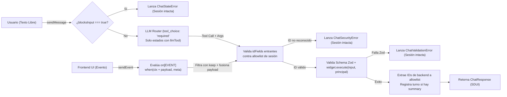

# `chat-framework`

[](https://www.npmjs.com/package/chat-framework)
[](./LICENSE)

Motor **agnóstico de industria** para construir asistentes conversacionales transaccionales combinando **Máquinas de Estados Finitas (FSM)**, **Server-Driven UI (SDUI)** y **Clasificación de Intención con LLMs (`tool_choice: 'required'` + Zod)**.

---

## ¿Qué hace y qué NO hace?

### Qué hace
* **Devuelve estados de interfaz (SDUI), no prosa libre del asistente:** Cada turno resuelve a un `ChatResponse` determinístico (`state`, `component`, `dataSource`, `context`, `data`, `blocksInput`, `canCancel`). El *copy* y la presentación visual viven en tu frontend según el `component` retornado.
* **Restringe al LLM a un clasificador de 1 salto (`tool_choice: 'required'`):** En cada `sendMessage()`, el LLM recibe únicamente las herramientas de los estados que declaran `llmTool` y está obligado a elegir exactamente una. Los estados críticos sin `llmTool` (ej. confirmación de pago, emisión de comprobante o reserva final) son invisibles e inalcanzables para el LLM.
* **Valida invariantes con Zod y controla referencias de sesión (`idFields`):** Garantiza que ningún argumento del LLM ni payload de evento de UI (`sendEvent`) pueda inyectar un identificador (`idField`) que no haya sido emitido previamente por el backend (`widget.execute()`) en la misma sesión.

### Qué NO hace
* **Sin texto libre ni streaming de tokens:** No es un chatbot de conversación abierta ni hace streaming de texto.
* **Sin bucle multi-agente (ReAct):** Ejecuta exactamente **1 tool-call por mensaje de usuario**. Si un estado necesita lógica interna adicional (como consultar un RAG o llamar un microservicio), la resuelve dentro de su propio `widget.execute()`.
* **Sin persistencia distribuida incluida:** Incluye `InMemoryChatMemory` para desarrollo/tests (sin TTL). Para producción multi-instancia debes implementar la interfaz `ChatMemory` sobre Redis o PostgreSQL (ver sección [Implementar `ChatMemory` en producción](#implementar-chatmemory-en-producción-redis--postgres)).

---

## Instalación y Requisitos

* **Módulos:** Paquete **ESM-only** (`"type": "module"`). Si tu proyecto usa CommonJS (`require`), deberás migrar a ESM o cargarlo con `await import('chat-framework')`.
* **Node.js:** `>= 18.0.0`
* **Zod:** `^3.24.0` (compatible con **Zod 3**, no Zod 4).

```bash
npm install chat-framework openai zod
```

Para compilar y ejecutar las pruebas del repositorio local (incluyendo el ejemplo ejecutable en `examples/clinic/`):

```bash
npm install
npm test
```

---

## Arquitectura



---

## Conceptos Clave

| Concepto | Descripción |
| :--- | :--- |
| **`Widget` (`BaseWidget`)** | Unidad de cada estado. Define `component` (nombre del widget SDUI para el frontend), `dataSource` (`'client'` o `'backend'`), `schema` (instancia `z.ZodObject`) y `execute(input, principal)`. |
| **`llmTool`** | Si un estado define `llmTool: { description, schema? }`, se expone como función al LLM. Si se omite, el LLM no sabe que el estado existe y cualquier intento de invocarlo lanza `ChatSecurityError`. |
| **`llmTool.schema`** | Esquema Zod opcional para cuando el LLM invoca el estado con parámetros en lenguaje natural (ej. `{ specialty: 'Pediatría' }` o datos pegados de una cuenta) distintos al esquema interno del estado (`{ doctorId }`). En este modo, `widget.execute()` resuelve la entidad en el backend y el framework sincroniza el `idField` resultante en el contexto. |
| **`blocksInput`** | Cuando es `true`, cualquier llamada a `chat.sendMessage()` lanza `ChatStateError`. Obliga a que el usuario complete el flujo mediante eventos de UI (`sendEvent`) o lo aborte con `chat.cancel()`. |
| **`idFields`** | Lista de llaves del contexto (ej. `['doctorId', 'patientId']`) sujetas a control de referencia de sesión. Solo acepta valores que hayan sido devueltos previamente por `widget.execute()` en el backend durante la sesión actual. |
| **`on` y `keep`** | Define las transiciones determinísticas desde eventos de UI. `keep` declara qué propiedades del estado origen se conservan hacia el estado destino (verificado estáticamente por TypeScript). |
| **`when(ctx, meta)`** | Guarda booleana para transiciones condicionales. **`ctx` es la fusión del contexto del estado actual más el payload del evento (`CurrentStateContext & EventPayload`)**, y `meta` contiene `{ previousState, history }`. |
| **`summary(input, data)`** | Genera la línea de resumen que se inyecta en el prompt del LLM en turnos futuros. **Importante:** Si un estado omite `summary`, la transición cambia el estado actual pero **no agrega una entrada al historial de turnos (`turns`) que lee el LLM**. |
| **`cancel`** | Destino al llamar `chat.cancel()`. Puede ser un nombre de estado fijo (`'IDLE'`), `null` (no cancelable), o una función `(ctx, meta) => ({ to, keep }) | StateName`. |

---

## Modelo de Seguridad: qué se garantiza y qué no

Es fundamental distinguir entre **integridad de flujo/referencia en la sesión** (lo que resuelve `chat-framework`) y **autorización de negocio / pertenencia de datos** (lo que debe resolver tu backend en `widget.execute`):

1. **Allowlist de sesión alimentada exclusivamente por el backend (`idFields`):**
   * El motor recolecta todos los nombres de campos declarados en `idFields` a lo largo de la máquina de estados.
   * **Ningún cliente (`sendEvent`) ni el LLM (`sendMessage`) pueden introducir un valor nuevo para un `idField`.** Si el payload de `sendEvent` o los argumentos del LLM contienen un `doctorId`, `patientId` o `appointmentId` que no fue retornado previamente por `widget.execute()` en esa misma sesión (`chatId`), el motor lanza `ChatSecurityError` antes de ejecutar el estado.
   * Cuando se crea un recurso nuevo (ej. registrar un paciente o emitir un ticket), el cliente debe enviar únicamente los **datos del formulario** (ej. `{ dependentName: 'Lucas' }`) y es `widget.execute(input, principal)` en el backend quien genera el nuevo ID y lo retorna para que ingrese a la allowlist de la sesión.
2. **Qué pasa cuando usas `llmTool.schema`:**
   * Si un estado define `llmTool.schema` (por ejemplo, recibe `{ specialty }` en vez de `{ doctorId }`), el motor valida primero que cualquier `idField` que venga en los argumentos esté permitido, ejecuta `widget.execute()` en el backend para resolver la entidad, sincroniza el `idField` devuelto en el contexto y **ejecuta `validateRequiredIdFields` después de `execute()`** para garantizar que el estado nunca quede sin su `idField` validado.
3. **Lo que el framework NO hace por ti (Autorización sobre `Principal`):**
   * El framework garantiza que el usuario solo pueda referenciar IDs que tus propios widgets devolvieron en su sesión.
   * **Tu método `widget.execute(input, principal)` sigue siendo responsable de filtrar las consultas y mutaciones en base de datos usando `principal.userId` / `principal.companyId`** (ej. `WHERE user_id = principal.userId`). Si un widget devuelve por error registros de otros clientes en un listado, el framework asumirá que esos IDs son legítimos para la sesión.

---

## Manejo de Errores y Atomicidad

Todas las transiciones en `Chat` (`sendMessage`, `sendEvent`, `cancel`) son **atómicas respecto a la memoria de la sesión**: si ocurre cualquier error de estado, seguridad o validación Zod, `memory.recordTransition()` no se ejecuta y la sesión permanece intacta en el estado y contexto previos.

| Error | Cuándo se lanza | Acción recomendada en la aplicación |
| :--- | :--- | :--- |
| **`ChatStateError`** | • Se llama a `sendMessage()` cuando el estado actual tiene `blocksInput: true`.<br>• Se envía un evento en `sendEvent()` que no está definido en `on` para el estado actual.<br>• Se llama a `cancel()` en un estado con `cancel: null`. | Informar en la UI que debe completar o cancelar el formulario activo antes de escribir en el chat. |
| **`ChatSecurityError`** | • El LLM o un evento de UI envía un `idField` que no pertenece a la allowlist de la sesión.<br>• El LLM intenta invocar un estado inexistente o que no tiene `llmTool`.<br>• Un estado con `idFields` termina su ejecución sin haber resuelto el ID requerido. | Registrar el evento de seguridad y mostrar un mensaje de recuperación (*"No pudimos procesar esa referencia, por favor selecciónala nuevamente de la lista"*). |
| **`ChatValidationError`** | • Los argumentos del LLM o el contexto resultante de una transición no cumplen el `schema` de Zod del estado destino. | Mostrar el detalle de validación al usuario o pedirle que reformule su solicitud con datos válidos. |

```ts
import {
  ChatSecurityError,
  ChatStateError,
  ChatValidationError,
} from 'chat-framework';

try {
  const response = await chat.sendMessage(userText);
  return renderSDUI(response);
} catch (err) {
  if (err instanceof ChatStateError) {
    return showToast('Completa o cancela la operación en pantalla para continuar.');
  }
  if (err instanceof ChatSecurityError || err instanceof ChatValidationError) {
    return showAssistantError('No pudimos validar los datos de la solicitud.');
  }
  throw err;
}
```

---

## Referencia de API

### `new Chat(config: ChatConfig<TWidgets>)`
Instancia el orquestador para un `chatId` y `principal`.
* **`chat.sendMessage(userMessage: string): Promise<ChatResponse<TWidgets>>`**: Clasifica la intención con el LLM y transiciona al estado elegido.
* **`chat.sendEvent(eventName, payload?): Promise<ChatResponse<TWidgets>>`**: Dispara una transición determinística definida en `on` del estado actual.
* **`chat.cancel(): Promise<ChatResponse<TWidgets>>`**: Cancela el estado actual y transiciona al destino configurado en `cancel`.
* **`chat.getCurrentState(): keyof TWidgets & string`**: Devuelve el nombre del estado activo en la sesión.

### `ChatResponse<TWidgets>`
Objeto devuelto tras cada transición exitosa:
```ts
interface ChatResponse<TWidgets> {
  chatId: string;
  state: keyof TWidgets & string;               // Estado activo actual
  previousState: (keyof TWidgets & string) | null;
  component: string;                            // Nombre del componente SDUI a renderizar
  dataSource: 'client' | 'backend';
  blocksInput: boolean;                         // Si el frontend debe deshabilitar el input de texto
  canCancel: boolean;                           // true cuando el estado actual tiene `cancel !== null`
  context: Record<string, any>;                 // Contexto validado por Zod del estado actual
  data: unknown;                                // Resultado de `widget.execute()` (`null` si `dataSource === 'client'`)
  summary?: string;                             // Resumen registrado en la memoria de turnos
}
```

### `Principal`
Identidad autenticada del usuario que ejecuta la sesión, pasada como segundo argumento a `widget.execute(input, principal)`:
```ts
interface Principal {
  userId: string;
  companyId?: string;
  roles?: string[];
}
```

### `zodToOpenAIToolParameters(schema?: z.ZodTypeAny): ToolParametersSchema`
Helper exportado que convierte un `z.ZodObject` en la definición JSON Schema compatible con OpenAI Function Calling (`type: 'object'`, `properties`, `required`, `minimum`, `maximum`, `enum`).

### Implementar `ChatMemory` en Producción (Redis / Postgres)
`InMemoryChatMemory` guarda las sesiones en un `Map` en RAM sin expiración (TTL), pensado para tests o procesos single-node. En producción puedes usar `memory.clearSession(chatId)` o implementar `ChatMemory` sobre Redis serializando `allowedIds` (`Set<string>` $\leftrightarrow$ `string[]`):

```ts
import type { ChatMemory, SessionSnapshot } from 'chat-framework';

export class RedisChatMemory implements ChatMemory {
  // Implementa getSession, recordTransition, isIdAllowed, registerAllowedIds y clearSession
  // aplicando un TTL en Redis por cada `chatId`.
}
```

---

## Ejemplo: clínica digital

El código completo, compilable y verificado por tests se encuentra en el directorio [`examples/clinic/`](./examples/clinic/):
* [`examples/clinic/widgets.ts`](./examples/clinic/widgets.ts): Widgets con esquemas Zod (`SearchDoctorsWidget`, `DoctorDetailWidget`, `StartBookingWidget`, `RegisterPatientWidget`, `ConfirmBookingWidget`, `BookingTicketWidget`).
* [`examples/clinic/clinic-chat.ts`](./examples/clinic/clinic-chat.ts): Definición de la máquina de estados médica, incluyendo `llmTool.schema`, retorno inteligente desde el sub-flujo de registro de paciente y cancelación contextual.
* [`examples/clinic/verify.ts`](./examples/clinic/verify.ts): Suite ejecutable que verifica el flujo completo y comprueba que la inyección de un `patientId` ajeno (`"pat-DE-OTRO-USUARIO"`) en `sendEvent` es rechazada con `ChatSecurityError`.

### Fragmento de `examples/clinic/clinic-chat.ts`

```ts
      START_BOOKING: {
        widget: new StartBookingWidget(),
        // Demostración de `llmTool.schema`: el LLM puede invocar START_BOOKING con `{ specialty, slot }`
        // en lenguaje natural y `StartBookingWidget.execute()` resuelve el `doctorId` en el backend.
        llmTool: {
          description:
            'Inicia el agendamiento de una consulta médica indicando la especialidad y opcionalmente el horario.',
          schema: DirectBookingBySpecialtySchema,
        },
        summary: (p) => `inició reserva con médico ${p.doctorId}`,
        blocksInput: true,
        cancel: 'IDLE',
        idFields: ['doctorId'],
        on: {
          SELECT_PATIENT: {
            to: 'CONFIRM_BOOKING',
            keep: ['doctorId', 'slot'],
          },
          NEW_DEPENDENT_PATIENT: {
            to: 'REGISTER_PATIENT',
            keep: ['doctorId', 'slot'],
          },
        },
      },

      REGISTER_PATIENT: {
        widget: new RegisterPatientWidget(),
        llmTool: {
          description: 'Abre el formulario para inscribir una nueva carga familiar o paciente.',
        },
        summary: () => 'abrió el formulario de registro de paciente',
        blocksInput: true,
        cancel: (_ctx, meta) =>
          meta.previousState === 'START_BOOKING'
            ? { to: 'START_BOOKING', keep: ['doctorId', 'slot'] }
            : 'IDLE',
        on: {
          PATIENT_REGISTERED: [
            {
              to: 'CONFIRM_BOOKING',
              when: (_ctx, meta) => meta.previousState === 'START_BOOKING',
              keep: ['doctorId', 'slot'],
            },
            {
              to: 'IDLE',
            },
          ],
        },
      },
```

---

## Comparativa con LangGraph, XState y Botonic

* **Frente a LangGraph:** LangGraph está diseñado para grafos agénticos abiertos (bucles ReAct, múltiples llamadas de herramientas en serie y sub-agentes autónomos). Para asistentes transaccionales con Server-Driven UI donde cada turno es `1 Tool Call -> 1 Pantalla Determinística`, LangGraph no provee primitivas para `blocksInput`, `idFields`, `keep` ni contratos SDUI (`component`/`dataSource`), obligando a escribir esa lógica de forma imperativa y perdiendo el tipado estático cruzado entre estado origen y destino.
* **Frente a XState:** `chat-framework` toma inspiración directa de XState (`states`, `on`, `when`), pero añade de fábrica la integración con Tool Calling de LLMs (`llmTool`), la extracción y validación automática de `idFields` desde ejecuciones de backend, y la generación de historial compacto (`summary`) para la ventana de contexto del modelo.
* **Frente a Botonic / Frameworks de Chatbots clásicos:** A diferencia de los frameworks basados en árboles de texto o expresiones regulares, `chat-framework` delega la extracción semántica de parámetros a esquemas Zod con Function Calling y devuelve descriptores de estado SDUI agnósticos del canal de renderizado (Web, Mobile, CLI).

---

## Autor

**Luis Francisco Barra Sandoval**

## Licencia

Este proyecto se distribuye bajo la licencia **MIT**. Consulta el archivo [LICENSE](./LICENSE) para más detalles.

Copyright (c) 2026 Luis Francisco Barra Sandoval.
